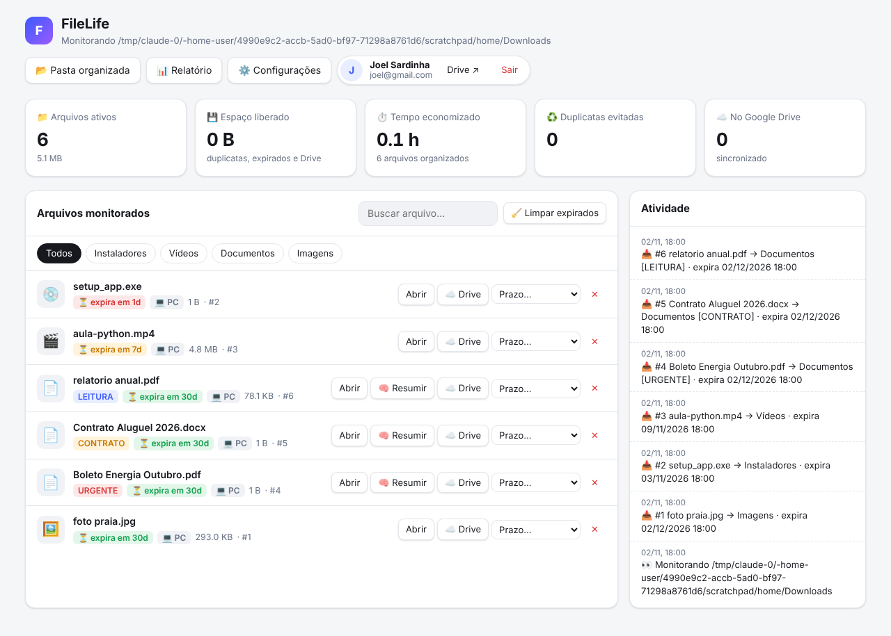

# FileLife

Seus arquivos organizados no Google Drive, com prazo de validade, sem duplicatas e com resumo por IA. Funciona no navegador, em qualquer sistema, sem servidor. Há também uma versão opcional para PC, que vigia a pasta Downloads em segundo plano.

## FileLife Web (versão principal)

Site que roda no navegador, em **qualquer sistema** (Windows, Mac, Linux, celular), **sem servidor**: os arquivos vão direto do navegador do usuário para o Google Drive dele. Fica em `web/`.

- **Entrar com Google:** o FileLife cria a pasta `FileLife` no Drive e só enxerga o que ele mesmo criou (permissão `drive.file`).
- **Organizar:** arraste arquivos ou conecte uma pasta do computador (Chrome/Edge). Eles vão para `FileLife/<Categoria>` com nome padronizado e tag (`[URGENTE]`, `[CONTRATO]`…).
- **Sem duplicatas:** a impressão digital SHA-256 impede guardar o mesmo arquivo duas vezes.
- **Prazo de validade:** cada categoria tem um prazo padrão. Vencido o prazo, o arquivo vai para `FileLife/_ArquivoFrio` (dá para restaurar) ou para a lixeira do Drive. Nada é apagado de vez.
- **Libera espaço no PC:** a cópia do computador só é removida depois de o Drive confirmar que recebeu o arquivo idêntico.
- **Resumo com IA (opcional):** PDFs e textos resumidos em 3 tópicos, com a chave da Anthropic do próprio usuário, que fica só no navegador dele.
- **Relatório** com estatísticas, que dá para imprimir ou salvar em PDF.

**Segurança:** o token do Google fica só na memória da aba (some ao fechar ou ao clicar em "Sair", que também revoga o acesso). A tela nunca monta HTML a partir de dados de fora, e a política de segurança (CSP) restringe o que a página pode carregar e com quem pode falar. O site não abre dentro de molduras de outros sites, e envios grandes são retomados se a conexão cair. Testado de ponta a ponta com Google e IA simulados.

> **Limitação dos navegadores:** um site não consegue vigiar a pasta Downloads com a aba fechada. Com a aba aberta, o envio automático da pasta conectada funciona (Chrome/Edge). Os prazos são processados sempre que o site é aberto.

### Colocar o site no ar

1. **Google Cloud** (uma vez, ~5 min) em https://console.cloud.google.com:
   1. Crie um projeto (ex.: "FileLife").
   2. **APIs e serviços → Biblioteca:** ative a **Google Drive API**.
   3. **APIs e serviços → Tela de permissão OAuth:** escolha "Externo". Preencha o nome do app, o e-mail de suporte, a página inicial (`https://telsat97.github.io/FileLife/`) e a política de privacidade (`https://telsat97.github.io/FileLife/privacy.html`). Em **Escopos**, adicione `.../auth/drive.file`. Em **Usuários de teste**, adicione o seu Gmail.
   4. **Credenciais → Criar credenciais → ID do cliente OAuth → "Aplicativo da Web"**. Em **Origens JavaScript autorizadas**, coloque `https://telsat97.github.io`.
   5. Copie o **ID do cliente** (termina em `.apps.googleusercontent.com`). Ele é público, não é segredo.
2. Cole o ID em `web/config.js`, no campo `googleClientId`, e faça o commit.
3. No GitHub: **Settings → Pages → Source: GitHub Actions**. Depois, em **Actions → "Publicar site" → Run workflow**.
4. Abra https://telsat97.github.io/FileLife/ e clique em **Entrar com Google**.

Para liberar o acesso a qualquer pessoa (e não só aos usuários de teste), clique em **Publicar app** na tela de permissão OAuth. Como `drive.file` não é um escopo sensível, a verificação do Google é simples.

**Testar no seu computador:**
```bash
cd web
```
```bash
python3 -m http.server 8080
```
Para testar assim, adicione `http://localhost:8080` às origens autorizadas do ID do cliente.

---

## Versão para PC (opcional)

Programa para quem quer a pasta Downloads organizada em segundo plano, mesmo com o navegador fechado.

### Comece aqui

1. **Baixe o programa** em [Releases](https://github.com/Telsat97/FileLife/releases): `FileLife-Windows.zip` ou `FileLife-Mac.zip`. Extraia e abra. Não precisa instalar Python.
2. **(Opcional) Google Drive:** crie as credenciais no Google Cloud (passo a passo abaixo, em "Configurar o Google Drive", ~5 min). No FileLife, clique em **📄 Importar credenciais do Google** e depois em **Entrar com Google**.
3. **(Opcional) Resumo com IA:** em ⚙️ Configurações, cole sua chave da Anthropic e ligue "Resumir documentos".
4. **(Opcional)** Em ⚙️ Configurações, ligue **Iniciar junto com o computador**.

> Para gerar uma nova versão dos executáveis, crie uma tag `vX.Y.Z` no GitHub. A automação em `.github/workflows/build.yml` gera os arquivos de Windows e Mac e publica em Releases.

## Interface gráfica



```bash
python filelife_app.py
```

O painel abre no navegador, só no seu computador (`127.0.0.1`). Nele você:
- **Entra com a conta Google**: um clique abre o login do Google, e daí em diante os arquivos grandes vão para o seu Drive.
- Vê seus arquivos com categoria, tag, prazo (verde, amarelo ou vermelho) e se estão no PC ou no Drive.
- Muda o prazo, mantém um arquivo para sempre, expira na hora, resume com IA, envia ao Drive e restaura versões.
- Acompanha a atividade em tempo real e as estatísticas (espaço liberado, horas economizadas, duplicatas).
- Muda as configurações (pasta monitorada, prazos por categoria, Drive, IA) sem mexer em JSON.

Com `pip install pywebview`, ele abre numa janela própria, como um programa normal. Use `--browser` para forçar o navegador.

**Gerar o `.exe` da interface:**

```bash
pyinstaller --onefile --noconsole --add-data "ui.html;." --name FileLife filelife_app.py
```

(No Mac/Linux, troque `;` por `:` em `--add-data`.)

## Uso pelo terminal

```bash
python filelifecycle.py                      # monitora ~/Downloads em segundo plano
python filelifecycle.py --organize-existing  # organiza também o que já está lá
python filelifecycle.py --watch D:/OutraPasta
```

O núcleo roda só com Python 3.8+. Extras opcionais:

```bash
pip install -r requirements.txt
```

- `send2trash` (recomendado): o que o FileLife remove vai para a Lixeira do Windows/Mac.
- `anthropic`: resumo com IA. Também precisa da variável `ANTHROPIC_API_KEY` (crie uma chave em https://platform.claude.com).
- `pyzipper`: zips do Arquivo Frio com senha AES.

Ele não pergunta nada a cada download: cada categoria tem um prazo padrão (editável em `~/.filelife/config.json`) e você ajusta pelo terminal:

| Comando | O que faz |
|---|---|
| `status` | resumo e próximas expirações |
| `list [categoria]` | lista arquivos ativos com seus IDs |
| `extend <id> <prazo>` | novo prazo (`3d`, `2w`, `1m`, `1y`) |
| `keep <id>` | nunca expirar |
| `expire <id>` | expira agora |
| `versions <id>` / `restore <id> <n>` | histórico de versões |
| `archive <id>` | local do zip e senha |
| `summary <id>` | gera ou refaz o resumo com IA |
| `cloud <id>` | envia para a nuvem e deixa um atalho |
| `open <id>` | abre o arquivo (no navegador, se estiver no Drive) |
| `drive login` | conecta sua conta do Google Drive |
| `cleanup` | processa expirados agora |
| `report [dias]` | gera relatório de produtividade |

Downloads em andamento (`.crdownload`, `.part`…) são ignorados, e um arquivo só é processado quando o tamanho dele para de mudar.

## Empacotar

```bash
pip install pyinstaller
pyinstaller --onefile filelifecycle.py
```

## 7 funções "Foda"

Todas implementadas ✅

1. ✅ **Dedupe Inteligente** — detecta arquivos repetidos por hash (MD5/SHA) e mantém só uma versão. *"Nunca mais tenha 5 versões do mesmo PDF no seu PC."*
2. ✅ **Resumo de Conteúdo (IA)** — gera resumo de 3 bullets para PDFs/Docs em um `.md` ao lado. *"Baixou um relatório de 40 páginas? Eu já li e resumi o que importa."*
3. ✅ **Auto-Compressão (Arquivo Frio)** — expirados podem ir para `.zip` com senha gerada. *"Seu histórico não é lixo, é memória."*
4. ✅ **Cloud Bridge** — arquivos grandes vão para Google Drive/OneDrive e viram atalho local. *"Seu SSD agradece."*
5. ✅ **Tags de Prioridade** — prefixos como `[URGENTE]`, `[ARQUIVO]`, `[LEITURA]`. *"Sua pasta de Downloads vira um dashboard de prioridades."*
6. ✅ **Backup Diferenciado (Versioning)** — salva versão anterior ao modificar arquivos em `OrganizedFiles`. *"Esqueceu como era aquele contrato antes da última edição?"*
7. ✅ **Relatório de Produtividade** — PDF semanal com estatísticas de arquivos, tempo e GB liberados. *"Prova de que seu PC está mais limpo."*

## Detalhes das funções 2 e 4

**Resumo com IA.** PDFs, `.docx` e arquivos de texto da categoria Documentos são resumidos em 3 tópicos pelo Claude (modelo `claude-opus-5-5`, configurável em `ai_model`). O resumo fica salvo em `<arquivo>.resumo.md`, ao lado do original. Ele roda em segundo plano, sem travar o monitor. O fallback automático da API (`fallbacks: "default"`) está ativado: se o modelo recusar um conteúdo, outro modelo tenta resumir. Arquivos acima de `ai_max_mb` (padrão 30 MB) são pulados. Para desligar, use `"ai_summary": false`.

**Cloud Bridge (Google Drive).** Vídeos e arquivos compactados acima de `cloud_min_mb` (padrão 200 MB) são **enviados direto para o seu Google Drive pela internet**, sem precisar instalar o app do Drive. Eles ficam em `Meu Drive/FileLife/<Categoria>`, a cópia local é apagada e, no lugar, fica um atalho que abre o arquivo no navegador (drive.google.com). Você também pode abrir com o comando `open <id>`. Os envios rodam em segundo plano. Se um envio falhar, o arquivo continua no PC.

Quando expiram, os arquivos vão para `Meu Drive/FileLife/_ArquivoFrio` (`on_expire: "archive"`) ou para a lixeira do Drive (`"delete"`), onde dá para recuperar por 30 dias.

O FileLife só consegue ver e mexer nos arquivos que ele mesmo enviou (permissão `drive.file`). O resto do seu Drive fica inacessível para ele.

### Configurar o Google Drive (uma vez, ~5 min)

1. Acesse https://console.cloud.google.com/ e crie um projeto (ex.: "FileLife").
2. Em **APIs e serviços → Biblioteca**, ative a **Google Drive API**.
3. Em **APIs e serviços → Tela de permissão OAuth**, escolha "Externo", preencha o nome do app e o seu e-mail e, em **Usuários de teste**, adicione o seu Gmail.
4. Em **APIs e serviços → Credenciais → Criar credenciais → ID do cliente OAuth**, escolha o tipo **"App para computador"**.
5. Baixe o JSON.
6. No FileLife, clique em **📄 Importar credenciais do Google**, escolha o JSON e depois clique em **Entrar com Google**. O navegador abre, você autoriza, e pronto: o login fica salvo.

> Para vender o produto: os passos 1 a 5 são feitos **só por você**, e o seu `google_credentials.json` vai junto com o programa. Seus clientes só fazem o passo 6 (login no navegador). Com mais de 100 usuários, publique o app na tela de permissão OAuth.

**Alternativa com o app do Drive instalado:** defina `"cloud_mode": "pasta"`. Nesse modo, o FileLife usa a pasta sincronizada (`G:\Meu Drive`, OneDrive ou Dropbox) em vez da API. Configure o app em "Fazer streaming de arquivos" para os arquivos não ocuparem o SSD. Para preferir OneDrive ou Dropbox, defina `"cloud_provider": "outro"`.

Para mandar mais coisas para a nuvem, diminua `cloud_min_mb` ou acrescente categorias em `cloud_categories`.

## Segurança e privacidade

O FileLife foi feito para **nunca perder um arquivo seu**:

- **Nada é apagado de vez.** Cópias repetidas e arquivos expirados no modo "apagar" vão para a Lixeira do sistema (com `send2trash`) ou para `~/.filelife/lixeira`, que só é esvaziada depois de 30 dias. No Drive, eles vão para a lixeira do Drive.
- **Uma cópia só é removida depois de conferida.** O FileLife compara o conteúdo (SHA-256) antes de tratar um arquivo como cópia: se você editou o original, o novo download é mantido. O zip do Arquivo Frio é testado antes de remover o original. O envio ao Drive é conferido por MD5 e tamanho antes de liberar o espaço no PC.
- **Pastas protegidas.** Não é possível monitorar a pasta pessoal inteira, a raiz do disco, pastas do sistema nem as pastas do próprio FileLife.
- **Downloads em andamento são respeitados.** Arquivos temporários (`.crdownload`, `.part`…), ocultos, de sistema (`desktop.ini`), arquivos abertos no Office (`~$…`) e links simbólicos são ignorados. Um arquivo só é movido depois de ficar 5 segundos sem mudar.
- **Configurações inválidas viram padrão seguro.** Um `config.json` quebrado ou com valores estranhos nunca faz o FileLife apagar nada.
- **Só uma cópia do programa roda por vez.**

**Privacidade:**
- Tudo roda no seu computador. O painel só responde ao próprio PC (`127.0.0.1`), exige um código secreto, recusa acessos vindos de outros sites e não pode ser embutido em outras páginas.
- O login do Google, o banco de dados e as configurações ficam em `~/.filelife`, legíveis só pelo seu usuário.
- No Google Drive, o FileLife só enxerga os arquivos que ele mesmo enviou (permissão `drive.file`). O botão "Sair" revoga o acesso.
- O **resumo com IA vem desligado**. Se você ligar, o conteúdo dos documentos é enviado à Anthropic.
- "Abrir" num programa baixado (`.exe`, `.msi`, scripts…) mostra a pasta em vez de executar o programa.

**Se for distribuir o FileLife:**
- **Nunca** coloque a sua `ANTHROPIC_API_KEY` dentro do programa: quem tiver o `.exe` conseguiria extraí-la e usar por sua conta. Cada pessoa usa a própria chave.
- O `google_credentials.json` ("App para computador") pode ir junto com o programa. Para apps desse tipo, o Google não trata o arquivo como segredo.
- Antes de passar de 100 usuários, publique o app na tela de permissão OAuth do Google.
- Assine o `.exe` (certificado de assinatura de código) para o Windows SmartScreen não bloquear o programa.
